<p align="center">
  <picture>
    <source media="(prefers-color-scheme: dark)" srcset="design/Full%20Logo%20Light.png">
    
  </picture>
</p>

# Kept

A clipboard history manager for Windows and Linux (**Beta**), built with Tauri 2 + React 19 + TypeScript + Tailwind CSS 4.

Everything stays on your machine. Clip contents are stored locally in SQLite; the only requests the
app makes are for a copied picture's own source file, a link's preview picture, GIPHY (with your key),
and its own update check — each described in [Security model](#security-model).

> **Linux support is Beta.** Most functionality should work on Linux (X11). The onscreen ruler works on
> X11; on Wayland it runs as an overlay without global shortcuts; other features are available subject
> to the platform notes below.

<p align="center">
  <a href="https://github.com/jamesbuckley-source/kept/releases/latest/download/Kept_x64-setup.exe">
    
  </a>
</p>

<p align="center"><sub>Windows: per-user NSIS installer · no admin prompt · Windows 10 and 11</sub></p>

## Download

### Windows

**[Download Kept for Windows](https://github.com/jamesbuckley-source/kept/releases/latest/download/Kept_x64-setup.exe)**
— a per-user NSIS installer, no elevation prompt, around 10 MB.

Installed copies update themselves: *Settings → About* checks GitHub once a day and installs signed releases in
place.

### Linux (Beta)

Linux packages are published on the [releases page](https://github.com/jamesbuckley-source/kept/releases/latest) for tagged releases:

- **AppImage** (`.AppImage`) — portable; mark executable and run (`chmod +x Kept*.AppImage && ./Kept*.AppImage`).
- **Debian/Ubuntu** (`.deb`) — install with `sudo apt install ./Kept_*_amd64.deb` (or your distro’s package tool).
- **Fedora/RHEL/openSUSE** (`.rpm`) — install with `sudo dnf install ./Kept-*.rpm` (or `rpm -i`).

Linux builds target X11-based desktops and may require standard Tauri/WebKitGTK runtime libraries provided by your distribution. See [docker/README.md](docker/README.md) for development environment details, known limitations, and X11 notes (including no-compositor behavior). **The onscreen ruler is available on Linux** and is described in [Onscreen ruler](#onscreen-ruler).

All versions, notes and artefacts (Windows and Linux) are on the
[releases page](https://github.com/jamesbuckley-source/kept/releases/latest). Auto-update behavior is currently focused on Windows signed releases.

## Screenshots

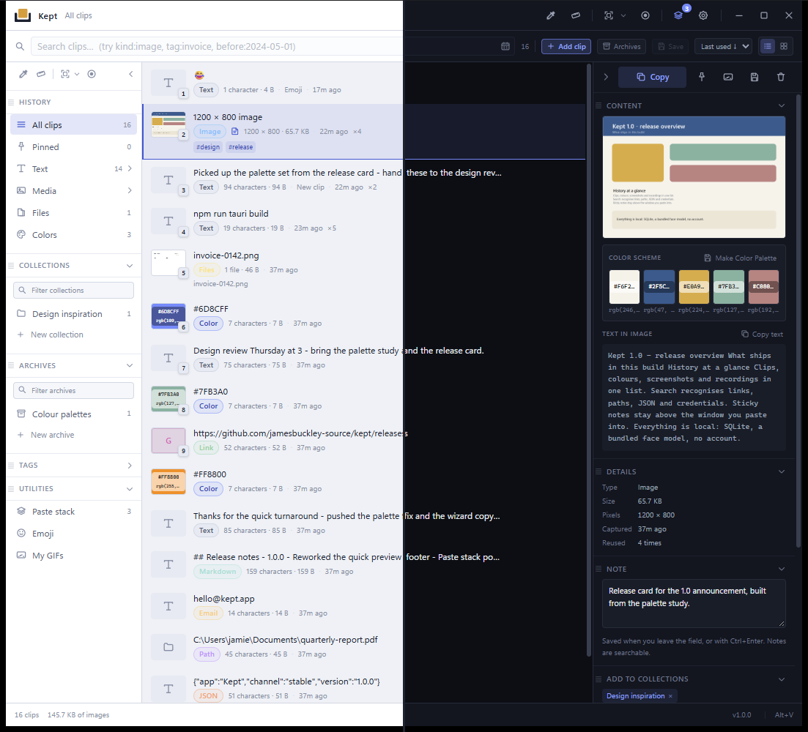

*The same history in both themes, light on the left and dark on the right: search and filters down
the side, clips in the middle, and the preview pane with the colour scheme, notes, collections,
archives and tags on the right.*

| | |
|---|---|
| 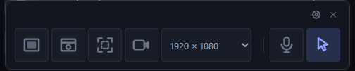 | 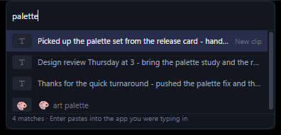 |
| *The recording bar: the four recording modes, the size, and the sound and pointer switches.* | *`::` in another application opens the quick paste box without leaving the sentence.* |
| 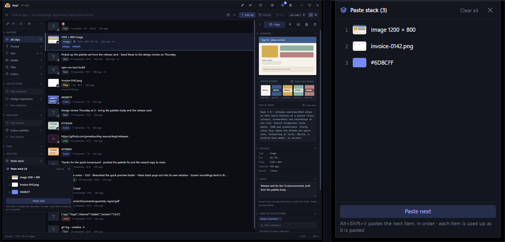 | 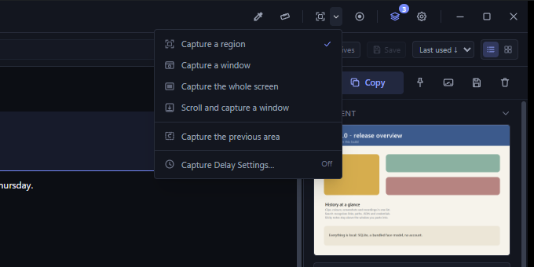 |
| *Stacks in the app, and in its own always-on-top window.* | *The capture button repeats the last kind; the chevron opens all of them.* |

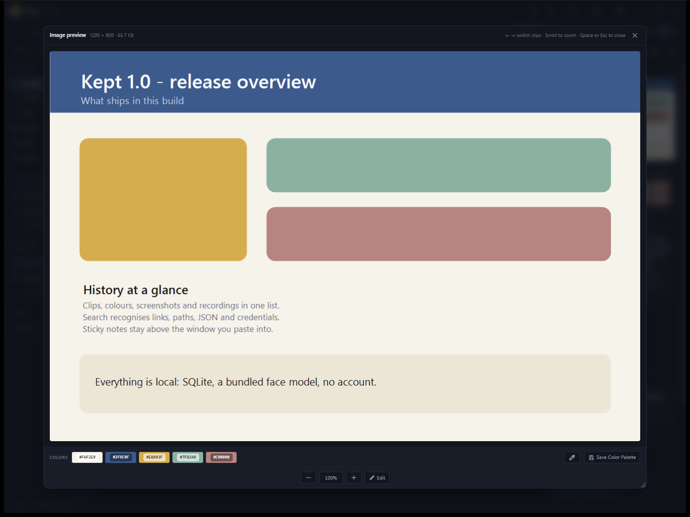

*`Space` opens the selected clip over a dimmed history. Images get zoom controls at the bottom; text
clips open in a larger editor.*

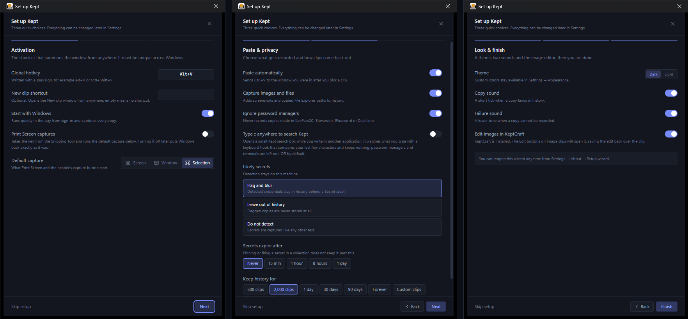

*The first-run wizard: the summon hotkey and capture choices, privacy and secrets, then retention,
theme and the image editor. It can be re-run from Settings at any time.*

## What it does

- **Captures** text, images and copied file lists as you copy them.
- **Records the screen** — window, region, a fixed-size frame or every monitor, with a microphone or
  a loopback device for sound, pause and stop controls, optional pointer, and hotkeys of their own.
  The result is a video clip in the history.
- **Drops in** files: dragging files from Explorer onto the window creates an image clip, a text clip or a file-list clip.
- **Keeps GIFs and videos moving** — copying an image from a browser recovers the source GIF or MP4
  and copies it back as a file, so every frame survives; the recovered asset is also what the app
  previews. Pasting the movie's own address does the same. A video copied this way also carries the
  address it came from as plain text, because plenty of targets refuse a dropped file and would
  otherwise paste nothing.
- **Recognises color codes** — a copied hex or `rgb()` value becomes a swatch with the code laid
  over it, with its own sidebar entry. Screenshot clips read their own colour scheme automatically,
  keeping the accents rather than a wall of greys.
- **Finds faces** in image clips with a detector that runs locally, so screenshots of people can
  be filtered as **Images → People**; only a count is stored, nothing is uploaded or compared.
- **Summons** with a global hotkey (`Alt+V` by default) as a frameless overlay, or from the tray.
- **Searches** as you type, ranked by exact match, word boundaries, position and recency. The
  Text view expands into Link, Email, Path, JSON and Secrets sub-views, and **Media** expands into
  Images (All), Screenshots, People, GIFs and Video; both states are remembered.
- **De-duplicates**: copying the same thing twice promotes the existing entry instead of
  stacking duplicates, and the clip you reuse jumps back to the top.
- **Organises** with pinning, collections and tags; collections can be turned into **archives**
  that stay out of the history and survive every bulk delete. Collections, archives and tags each
  have a filter box and a compact “Show all” list, and each sidebar section folds away with its
  state remembered. A section header spans the full width of the sidebar with a rule above and
  below that reaches both edges, its filter field keeps clear of that rule, and the four-line grip
  on the left of each header drags it into a new order.
- **Previews** the full text, the image, the video or each file path before you commit to using
  it. `Space` opens a larger quick preview sized to the picture, with zoom for images, a player with
  a scrubbable timeline for videos, and an auto-saving editor for text.
- **Previews links** from their address alone — the site's initial on a card — and, on request,
  fetches the page's own preview picture. Automatic fetching is off by default.
- **Writes clips by hand**: the **Add clip** button in the toolbar opens a small window with
  Markdown formatting buttons, and text containing Markdown is stored with a **Markdown** badge.
- **Two layouts** — rows for reading text, cards for browsing images — with a draggable card-size
  slider and a separate interface scale.
- **Themes** with dark and light presets, or a custom palette picked color by color.
- **Reads text out of screenshots** with OCR and makes it searchable (Windows OCR on Windows, Tesseract on Linux Beta); a hover
  button copies that text instead of the image.
- **Orders the history** by last use or capture date, in either direction, and remembers a
  list-or-cards layout per category.
- **Reveals** clips in Explorer from a right-click menu; each archive owns a folder there.
- **Updates itself** from signed GitHub releases, with a daily check you can turn off.
- **Pastes back** on demand into whatever you were working in (opt-in; off by default).
- **Pastes as you type** — with quick paste switched on, `::` in any other application opens a
  small search box and pastes the clip you pick into the window you were already writing in.
- **Pauses capture** on demand — a private mode for 15 minutes, an hour, or until restart.
- **Finds things with operators** — `kind:image`, `tag:invoice`, `app:code`, `before:2024-05-01`,
  `day:2024-05-01`,
  `color:#ff8800`, `in:archive` — and saves any query to the sidebar as a smart view.
- **Acts on what it recognises**: links open in the browser, paths open or reveal in Explorer,
  JSON can be pretty-printed, colors come with their hex and `rgb()` values. Recognised rows also
  carry their action as an inline button, so *Open link* / *Open Folder* is one click away.
- **Saves and drags** clips out: *Save as…* writes the image, the files or the text to a folder,
  and rows can be dragged straight into Explorer, an editor or a chat window.
- **Selects many at once** and pins, tags, files or deletes the whole selection.
- **Exports in bulk**: *Save to…* in the selection bar writes every picked clip into one folder.
- **Exports Markdown notes**: with a vault folder set in *Settings → Markdown*, a text clip
  becomes a dated note with YAML front matter — from the right-click menu, the preview pane,
  the selection bar or `Ctrl+Shift+M`.
- **Searches emoji** from a Utilities section, with favourites that survive restarts.
- **Browses GIPHY** from the same Utilities section, starring GIFs and saving image clips to a
  personal GIF shelf; click any result to copy the animation. The shelf also imports GIF files
  from disk.
- **Keeps notes** in a permanent archive: **Add Clip Note** (`Ctrl+N`) writes a clip the way a
  notepad would, and every note lands in *Utilities → Clip notes*, an archive, so retention and bulk
  deletes leave it alone. That view is the ordinary list and card layout with its own count, and its
  header says the notes are kept forever. Deduplicated text — a note whose text is already in the
  history — is not pulled into the archive, because that clip belongs where it was captured.
- **Annotates** clips with a searchable note, and edits a text clip in place from the preview pane.
- **Samples colors** from anywhere on screen with the eyedropper in the title bar; a magnifier
  beside the crosshair previews the pixel and its hex/RGB values before you click.
- **Takes screenshots** of a dragged region or of a whole window, straight into the history (on Linux Beta/X11, capture tools are available with the limitations noted in [docker/README.md](docker/README.md)); **Capture text** keeps the words recognised in a dragged region as a text clip instead of the picture, and **Capture QR code** reads the code in a dragged region, copies its payload and opens the link in your browser when it holds one.
- **Measures the screen** with an onscreen ruler: drag distances and boxes, click angles, drop
  guides from the edge rulers, and snap to window borders, colour edges, guides or a grid. It is
  available on Windows and on Linux (X11). Its icon-only toolbar names
  each tool on hover, the padlock locks it click-through so other apps stay usable (Esc unlocks,
  Esc again closes), and its Copy button puts the readout on the clipboard and in history in px,
  DIP or both.

## Requirements

| | Windows | Linux (Beta) |
|---|---|---|
| OS | Windows 10/11 | Linux with an X11 desktop/session (Wayland support may vary) |
| Node | 20+ | 20+ |
| Rust | 1.85+ (`rustup`; backend uses edition 2024) | 1.85+ (`rustup`; backend uses edition 2024) |
| Build tools | MSVC C++ build tools + Windows SDK | Standard build tools (`build-essential`, `pkg-config`, etc.) plus Tauri/WebKitGTK dev packages |
| Runtime UI stack | WebView2 (preinstalled on Windows 11; runtime download on older Windows 10) | WebKitGTK/GTK3 and distro-provided desktop libraries |

The Rust backend compiles SQLite from source, so there is no external SQLite library to install.
Screen recording encodes with **FFmpeg**, which is the one external runtime tool Kept may ask for:
on Windows it is looked for on `PATH` and in the folder a winget install leaves it in, and
**Settings → Screen Recording → Install FFmpeg** can fetch it with winget; on Linux install `ffmpeg`
with your package manager (and GStreamer plugins for playback as noted in [docker/README.md](docker/README.md)).
OCR is provided by Windows OCR on Windows and by `tesseract` on Linux. Everything else in the app works without FFmpeg.

## Getting started

```bash
npm install
npm run tauri dev          # dev build with hot reload
npm run tauri build        # optimised build + platform bundles/installers
```

### Windows development notes

Dev mode serves the UI on **port 5173** and HMR on 5174. (Tauri's scaffold default of 1420 falls
inside a Windows reserved port range on machines with Hyper-V or WSL enabled, where it fails with
`EACCES`.)

### Linux development notes (Beta)

On Linux you need a desktop session/display (X11) and the system dependencies required by Tauri/WebKitGTK,
plus tools used by Linux capture/clipboard features as applicable (e.g. `ffmpeg`, `tesseract`, `xdotool`,
`maim`, `xclip`) depending on the features you exercise. See [docker/README.md](docker/README.md) for a
known-good container setup, X11/no-compositor notes, and current limitations. **The onscreen ruler
is available on Linux**, with the Wayland caveats listed there.

The app starts hidden. Press **Alt+V** (or your configured global shortcut) or use the tray icon/menu to
bring it up. The very first launch shows the window instead, so it does not look like nothing happened. On
Linux, global shortcuts and tray integration depend on the desktop environment and session type.

## Building installers and packages

### Windows (NSIS installer)

`npm run installer` produces a per-user NSIS installer:

```
src-tauri/target/release/bundle/nsis/Kept_<version>_x64-setup.exe
```

It runs `npm run tauri build` with the updater signing key loaded, which is what
writes the `.sig` beside the installer. The key pair lives outside the repository
in `~/.tauri` (`copypaste.key`, `copypaste.password`, and the `copypaste.key.pub`
that `tauri.conf.json` already carries). A plain `npm run tauri build` skips that
step and ends with “a public key has been found, but no private key”, so it is
only useful for a build you never intend to distribute.

Releases published from a `v*` tag also attach the same installer under a stable name,
[`Kept_x64-setup.exe`](https://github.com/jamesbuckley-source/kept/releases/latest/download/Kept_x64-setup.exe),
which is what the download link above uses. The Windows tag build is signed with the updater key so
installed Windows copies can update in place.

It installs to `%LOCALAPPDATA%\Kept` with no elevation prompt and registers an entry in
*Apps & features* for uninstalling. NSIS is the open-source installer generator Tauri uses —
no telemetry, no bundled extras. Your data lives separately in
`%APPDATA%\ikept.it`, so uninstalling and reinstalling keeps your history (delete
that folder to start clean). An installation upgrading from the old CopyPaste build has its
previous folder carried across on the first launch: the pointer that names a custom history folder
comes with it, along with the database and media if the history lived in the default location. The
old `%APPDATA%\com.copypaste.app` folder is left in place, so a rollback still works.

### Linux (Beta packages)

To build Linux packages locally, install the required system dependencies for your distribution
(Tauri/WebKitGTK/GTK3 dev packages, `patchelf`, etc.), then run:

```bash
npm install
npm run tauri build -- --bundles deb appimage rpm
```

Artifacts are written under `src-tauri/target/release/bundle/` (for example `deb/*.deb`,
`appimage/*.AppImage`, `rpm/*.rpm`) depending on host support. Tagged GitHub releases build and
upload Linux packages automatically for end-user installation (see [Releases and automatic updates](#releases-and-automatic-updates)).
Linux support is **Beta**, including the onscreen ruler (see the Linux notes above). See
[docker/README.md](docker/README.md) for Linux development and platform limitations.

## Tray and background behaviour

Kept starts hidden and lives in the tray. Left-click the icon to toggle the window; right-click for
the full menu — **Open Kept**, *New clip…*, *Color Picker*, *Onscreen ruler*, a **Capture** submenu,
**Pause capture**, *Settings…*, *Data folder* and *Quit*.
The menu follows the state: a pause reads *Resume capture (12 min left)*, and *Lock vault* appears
only while the vault is open. On Linux (Beta), tray behavior and available integrations may vary by
desktop environment.

Closing the window hides it and the clipboard watcher keeps running; quitting is deliberate, from
the tray menu only. The window is an ordinary window rather than an always-on-top overlay unless
*Settings → Window → Always on top* says otherwise, losing focus does not dismiss it, and only one
copy runs at a time — launching again raises the running instance. *Launch at login* and *Show in
the taskbar* are settings.

## Keyboard

| Key | Action |
|---|---|
| `Alt+V` | Show / hide the overlay (*Settings → Activation → Global hotkey*) |
| `Ctrl+Alt+P` | Toggle private mode, pausing capture (*Settings → Activation → Private mode shortcut*) |
| `Alt+Shift+V` | Paste the next Stacks item and use it up (*Settings → Activation → Stacks shortcut*) |
| `Print Screen` | Capture the default kind, once *Settings → Capture → Print Screen* is switched on |
| `::` | Open the quick paste box while typing in another application (*Settings → Quick paste*, off by default) |
| `↑` `↓` | Move the selection |
| `PgUp` `PgDn` `Home` `End` | Jump through the list |
| `Enter` | Copy the selected clip, and paste it if auto-paste is on |
| `Ctrl+C` | Copy the selected clip and keep the overlay open |
| `Space` | Open the quick preview of the selected clip; `Space` or `Esc` closes it |
| `←` `→` | In the quick preview, show the previous or next clip and select it |
| `Ctrl+1` … `Ctrl+9` | Copy the clip with that slot number, and paste it if auto-paste is on |
| Double click | Copy the clip, and paste it if auto-paste is on |
| `Ctrl+Click` / `Shift+Click` | Add a clip to the selection, or select a range |
| `Ctrl+A` | Select every visible clip |
| `Ctrl+P` | Pin / unpin |
| `Ctrl+Shift+M` | Export the selected text clip(s) as Markdown notes, then hide the overlay |
| `Del` | Delete the selected clip, or the whole selection (only while the search box is empty) |
| `Esc` | Clear the selection, the clip or settings search, close settings, or hide the window |

The quick paste box has its own keys: `↓` reveals the recent list and walks down it, typing searches,
`Enter` pastes the highlighted clip and `Esc` closes the box without pasting.

The onscreen ruler has keys of its own. `Esc` closes it; a locked, click-through ruler shows an
**Unlock** button (on X11 the first `Esc` also unlocks it and the second closes it). Inside the
overlay, `V`/`D`/`B`/`A` choose select,
distance, box and angle, `G` toggles guides, `S` snapping, `C` copies, `L` locks, the arrow keys nudge
the active measurement (`Shift` for 10 px), `Tab` cycles measurements, `Delete` removes the active
one and `F5` refreshes the snapping snapshot.

**No default, yours to assign.** These global actions start with no shortcut and are recorded by
clicking the field and pressing the keys; an empty field means none:

| Action | Where |
|---|---|
| New clip | *Settings → Activation → New clip shortcut* |
| Region capture | *Settings → Capture → Capture shortcuts* |
| Window capture | *Settings → Capture → Capture shortcuts* |
| Full-screen capture | *Settings → Capture → Capture shortcuts* |
| Scrolling capture | *Settings → Capture → Capture shortcuts* |
| Text capture | *Settings → Capture → Capture shortcuts* |
| Capture the previous area | *Settings → Capture → Capture shortcuts* |
| Colour picker | *Settings → Capture → Capture shortcuts* |
| Onscreen ruler | *Settings → Capture → Capture shortcuts* |
| Record the screen | *Settings → Screen Recording* |
| Stop the recording | *Settings → Screen Recording* |
| Pause or resume the recording | *Settings → Screen Recording* |

A combination Windows refuses because another application owns it is reported and the previous one
stays active.

## Searching

The search box ranks as you type, and it also understands operators. Anything it does not
recognise stays part of the text query, so a stray colon never makes results vanish.

| Operator | Example | Effect |
|---|---|---|
| `kind:` | `kind:image` | Restrict to text, image or file clips |
| `type:` | `type:url` | Restrict to a recognised payload: `url`, `email`, `path`, `json`, `color`, `markdown`, `secret` |
| `tag:` | `tag:invoice` | Clips carrying that tag |
| `collection:` | `collection:Work` | Clips filed in that collection |
| `app:` | `app:chrome` | Substring match on the source application |
| `before:` | `before:2026-05-01` | Captured before that date |
| `day:` | `day:2026-05-01` | Captured on that day only |
| `color:` | `color:#ff8800` | Exact color match |
| `pinned:` | `pinned:yes` | Pinned clips only |
| `in:archive` | `kind:image in:archive` | Also reach clips kept in an archive |

Each operator appears as a chip under the input; click a chip to drop it. The **Archives** button
next to the sort dropdown does the same thing without typing.

The calendar icon inside the search field opens a date picker. Picking a day adds a `day:` token —
one calendar day, from local midnight to the next, so a daylight-saving change does not shave an
hour off either end — and **Clear** in the picker removes it. The rest of the query is left alone.

**Save** turns the current query into a sidebar entry under *Saved searches*. Saved searches are
stored with the rest of the settings, re-run with one click, and can be renamed or deleted from
their right-click menu.

## Private mode

*Pause capture* stops recording without changing any settings:

- From the tray menu: 15 minutes, 1 hour, until restart, or resume.
- From the keyboard: `Ctrl+Alt+P` toggles a 15-minute pause.
- From *Settings → Activation*, which also shows the current state.

While paused the watcher keeps advancing its clipboard counter, so whatever was copied during the
pause is never recorded when capture resumes. The status bar shows a pause chip with the remaining
time — click it to resume.

## Secrets

Kept flags text that looks like a credential — private-key blocks, `Authorization` headers, URLs
with embedded passwords, JWTs and the usual token prefixes (`ghp_`, `sk_live_`, `xox*`, `AIza`,
`AKIA`, …). The guess is made locally on the plaintext at capture time and only the confidence is
stored. A flagged clip stays blurred until **Reveal**, carries a gold **Secret** pill, and keeps its
first character and last three readable so two credentials can be told apart.

Detection is only a guess, so any text clip can be marked by hand with the shield in the preview
pane; pressing it again clears the flag. *Settings → Capture* adds **Guess from context** (noisier,
off by default) and **Leave secrets out of history**. Marking a clip secret in the vault encrypts
the text and its media — see [the vault](#the-vault).

## Stacks

Stacks is a queue of clips pasted **one at a time, in order**, into whatever program has focus. It is
the missing step between copying one clip and saving a collection: line up the things you need next
and use them up as you go.

- **Adding** — hover a clip in either layout and press the stacked-layers button, right-click it and
  choose *Add to Stack*, or select several and use **Stack** in the bulk bar. The same clip twice is
  two pastes, because a stack is a sequence rather than a set.
- **From a collection** — right-click a collection and choose *Convert to Stacks…*. The queue is
  replaced with that collection's clips in the order the list shows them; when something is already
  queued the entry reads *Replace the stack (N)…* so the click is deliberate.
- **From a text list** — right-click a text clip and choose *Split into stack items…*. Every line
  becomes its own item, in order. Markdown bullets (`-`, `*`, `+`, and `•`/`·`) and ordered markers
  (`1.`, `2)`, `(3)`, `a.`) are stripped, task boxes (`- [ ]`, `- [x]`) go with the marker, blank
  lines are dropped, and a marker only counts when a space follows it — so `**bold**` keeps its
  asterisks. Plain text with one item per line needs no markers at all. The lines are queued as
  lines, not stored as clips, so splitting a 30-line list does not bury the history.
- **Pasting** — `Alt+Shift+V` pastes the first item into the window you were in and removes it, ready
  for the next. Clicking *Paste next* in the panel does the same without the keyboard: it goes to the
  window you were in before Kept came forward. A clip that
  cannot be pasted — the vault is locked, or the media has gone — is refused with a message and stays
  queued rather than being silently dropped.
- **Pasting it all** — *Paste all* pastes the whole queue in order and keeps it: each item goes on the
  clipboard in its own native shape — a picture as a picture, text as text — and Kept sends the paste
  for each one. Nothing has to be reconstructed by the target, so a picture arrives as a picture in
  anything that accepts an image. It is the dependable choice when *Copy all* is pasted somewhere that
  will not take a styled document.
- **One clipboard, every flavour** — a copied picture is published as `CF_DIB` *and* as the registered
  `PNG` format *and* as HTML carrying the same picture as a data URI. Office, Paint and every Win32
  editor read the bitmap; Chromium-based editors — Google Docs among them — look for `PNG` or the HTML
  image, and used to get nothing they understood from a bare bitmap.
- **Copying it all** — *Copy all* puts the whole queue on the clipboard as one record: the text in
  order, with images embedded in the HTML and RTF flavours so word processors and documents keep
  them. The RTF is validated before it is published — a stream a reader would refuse is left out
  rather than published, since a reader that discards it falls back to the plain text. A target that
  only understands plain text gets each image's file path instead, which is all a text-only paste can
  carry; images too large to embed are referenced by `file://` URL in the HTML. It does not use
  anything up, so the queue is still there for *Paste next*.
- **Seeing it** — a badge in the title bar counts what is queued, and both that badge and
  *Utilities → Stacks* open the queue's own window. It lists the queue in order, with a thumbnail or
  the line itself, and each row has a × to drop it; **Clear all** empties the queue.
- **The window** — the queue lives in a small frameless window that stays above other applications, so
  it can sit beside the editor being pasted into. Drag it by its title; *Paste next*, *Paste all* and
  *Copy all* are the three icon buttons at the bottom, each with a tooltip. Closing it only closes the
  window: the queue is kept, and it comes back from the title-bar badge or *Utilities → Stacks*.
- **Dropping files** — drag files or folders from the desktop straight onto that window and they are
  imported like any other drop, then queued at the end, so a saved screenshot joins the stack without
  a detour through the history list. The window says how many it took, and a duplicate file queues the
  clip that is already there.

The queue lives in the history database, so it survives a restart. It holds up to 500 items; past
that the newest are refused with a message rather than the oldest being silently discarded. Deleting
a queued clip removes its row, while a line split out of a clip stays put — it is a copy, not a
reference.

## Quick paste

Typing `::` while writing in any application opens a small box that searches Kept without leaving
the sentence you are writing. It is the one part of Kept that works outside its own window, so it is
**off until you switch it on** in *Settings → Quick paste*.

- **What it opens on** — the clip you used a moment ago, one row, ready for `Enter`.
- **Down for more** — the first `↓` reveals the ten most recent copies; further presses walk down to older
  ones, and `↑` climbs back until the list collapses to the single row again.
- **Typing searches** — two characters turn the box into a search over the whole history, ranked the
  same way the overlay ranks it. `Backspace` back to empty returns to the recent list. With *Offer
  emoji* on, names are matched too (`::smile`).
- **`Enter` pastes** into the window you were typing in; `Esc`, a click outside or losing focus closes
  the box and pastes nothing.
- **What it offers** — text clips, and emoji matched by name.
- **The trigger is yours** — `Settings → Quick paste → Trigger` takes any run of up to six
  characters, with no spaces. It is matched against the characters the keyboard actually produces, so
  it works on layouts where `:` is not where you would expect it.
- **Where it stays out of the way** — *Never there* is a list of process names, pre-filled with the
  password managers and the terminal hosts. In those applications the trigger does nothing at all:
  no box, and the characters stay where you typed them. Kept's own windows never trigger it either.

How the trigger works, and why it asks permission first: noticing two characters typed in *another*
application needs a system-wide keyboard hook. Kept installs one only while the switch is on, and the
hook does exactly one thing — it compares the last few characters against your trigger and forgets
them. Nothing is logged, buffered to disk or sent anywhere, and the hook is removed the moment the
setting goes off. There are three consequences worth knowing:

- The two characters are typed into the document and then removed with two backspaces a moment
  later, so a very slow application may show them for a fraction of a second.
- A caret position is not available in every application — terminals and many Electron applications
  report none — and the box falls back to hanging under the mouse pointer.
- A window from a program running as administrator cannot be typed into from here, so the trigger
  stays inert over one rather than swallowing the characters and pasting nothing.

## Bulk actions

`Ctrl+Click` extends the selection, `Shift+Click` takes a range and `Ctrl+A` takes everything visible.
A bar above the list then offers **Pin**, **Unpin**, **Tag…**, **Collect…**, **Save to…** and
**Delete**; `Del` deletes the selection and `Esc` clears it. The right-click menu gains *Export N as
Markdown* (text clips only) and *Add N clips to Stack*, and the selection keeps its place after a
delete.

## Settings

Settings open in their own window from the gear in the title bar or *Settings…* in the tray menu, and
`Esc` closes them. The page is a run of collapsible sections — **About**, Appearance, Activation,
Pasting, Window, Screen Recording, Measure, Capture, Quick paste, Limits, Retention, Utilities,
Markdown, Image editor and Storage — with a search box that narrows the page as you type. Name
matches rank above description matches, and `Esc` clears the filter before it leaves settings. Every
change is broadcast to the other windows as it is saved, so a theme change repaints the history
immediately.

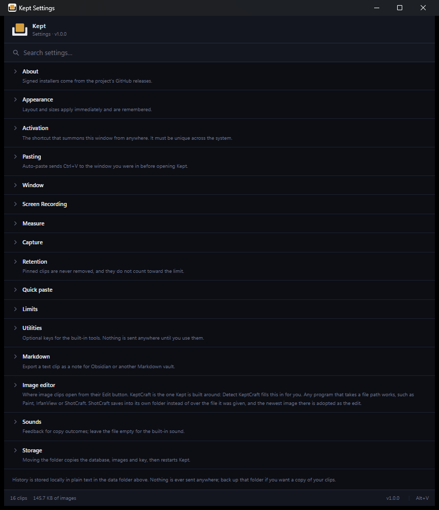

*One row per setting, with a hint wherever the choice needs one.*

On a fresh install a three-step **setup wizard** opens before this: the summon hotkey, capture and
privacy choices, secret handling, retention, theme and the image editor. *Settings → About → Setup
wizard* reopens it at any time.

**Storage.** *Data folder → Change…* copies the database and the media to the chosen folder and
restarts into it; a folder that is missing at startup falls back to the default one. Retention
accepts hours or days, `0` keeps everything and archived clips are exempt. A folder on a cloud drive
works — thumbnails are cached locally and reads to the drive are limited and retried.

**Markdown.** The export folder (empty asks each time), the YAML front matter and the
`YYYY-MM-DD` filename prefix are each a setting. The folder is never created, so a moved vault
reports the problem instead of looking successful.

**Image editor.** One field holds a whole command line. `{file}` marks where the clip's path goes and
is appended when missing, so `mspaint.exe` works as typed;
`C:\Program Files\KeptCraft\keptcraft.exe open-annotate --filepath {file}` is the working example,
and **Detect KeptCraft** fills it in. **Install KeptCraft…** next to it downloads the newest release
from GitHub over HTTPS, checks the file against the SHA-256 the release publishes and starts its own
installer, so the wizard and Settings never send you to a browser; a build with no published digest
is refused rather than trusted. Kept watches the file while the editor is open and refreshes the
clip on every save, including ShotCraft's habit of writing a new file each time.

**QR codes.** Any picture in the history is read on demand: a clip holding a code shows its payload
in the preview pane with an **Open link** button when the payload is an address, and nothing is
stored for it, so old clips are read the same way as new ones.

## Appearance

*Settings → Appearance* controls:

| Setting | Default | Notes |
|---|---|---|
| Show in the taskbar | **on** | Off makes the app tray-only |
| View per category | Media and colors: cards, others: rows | Each history category remembers its own list/cards choice |
| Card size | 100% | Drag the slider in the toolbar (60–200%); each history category keeps its own |
| Text scale | 100% | Scales the whole interface, 70–200% |
| Sidebar lists | 6 items | Collections and archives show this many before **Show all**; tags stop at 10 |
| Preview pane | shown | Collapse it with the chevron at the pane's top-left; the filter sidebar has its own chevron at its top-right. Its left edge drags to resize, and stops at the width where its own buttons still fit |
| Theme | Dark | Dark, Light, Custom, or one of six bundled presets, plus any theme you import |

Every window paints the theme's canvas color natively before its page draws, so opening Settings, a
sticky clip or Stacks never flashes the platform's default background first. The capture
overlays keep their transparency and are left alone.

A preset sets all twelve colours at once — Midnight, Slate, Sandstone, Forest, Mono and High
contrast ship with the app — and, when it carries one, the colour the capture overlays draw with;
that lands in the global outline field, so it stays editable afterwards. **Import theme…** reads a
`.zip` holding a `theme.json` (or a bare `theme.json`) and refuses anything incomplete: every colour
must be present and a real hex value, the name must be there, and the archive is only ever read for
that one file, never extracted. Imported themes are stored as one file each under the app data
folder rather than the (movable) data folder, so moving your clips does not lose your colours, and a
theme whose name matches a bundled one gets its own id instead of shadowing it. Removing an imported
theme that is currently applied leaves you in Custom with the same palette.

Each sidebar category (All clips, Text, Media, Files, Pinned, and collections/tags together) keeps
its own layout and card size: switching to cards for Media does not drag Text along with it, and
media starts in cards because a thumbnail grid is how you actually recognise a screenshot. Like the
preview pane, the whole filter sidebar folds away — the chevron at its top-right leaves a 28px rail,
and clicking anywhere on that rail brings it back. The choice is remembered. The collapsed rail
lists the eyedropper, ruler, each of the four capture kinds as its own icon, and record, so a
specific screenshot is one click without opening the capture menu. The search bar and its
toolbar sit above the sidebar and span the full window, so folding the sidebar away widens the
history without shortening the toolbar. Section headings in
both the sidebar and the preview pane are drag handles: drop one on another and the two swap places,
and the order is kept. The Text
row's chevron reveals Link, Email, Path, JSON and Secrets sub-views; double-clicking anywhere on
the row does the same, and the choice is remembered. **Media** works the same way and expands into
five views: **Images (All)** — every image clip, screenshots and recordings included, plus copied
image files — **Screenshots**, every capture the app's screenshot buttons have taken, recognised by
the “Screenshot” source the capture path records — **Screen recordings**, the clips the record button
made, recognised by their “Screen recording” source — **People**, the images the local face detector
found a face in — **GIFs**, the clips whose animated GIF was recovered from a copy — and **Video**,
the clips whose recovered asset is a video. Both GIF and Video views cover every clip kind, so a
pasted movie address appears under Video as well.

Copying a `.png` or `.jpg` in Explorer keeps the file where it is — Kept does not duplicate it — but
it generates the card's small preview from it, so the copy shows a thumbnail in **Files** and is
listed under **Images (All)** as well, beside the screenshots. Files captured before that existed get
their preview on the next start, in the same background pass as text recognition. Only files that
decode with the bundled PNG/JPEG codecs get a picture; anything else keeps the file-list glyph.

Images are also read with OCR in the background (Windows OCR on Windows, Tesseract on Linux Beta);
the recognised text is indexed for search, shown under the preview, and copyable from a button on
the card, where the copy lands in the history as its own text clip so it can be pinned, tagged or
searched later.
Images are additionally scanned for faces, also in the background — see [Facial recognition](#facial-recognition).

Themes are stored as a palette of twelve color tokens. Rather than shipping two stylesheets, the
selected palette is written onto the document as `--color-*` custom properties, which is what the
Tailwind utilities already compile to — so a theme change repaints everything without a rebuild.
Custom mode exposes every token as a swatch plus a hex field.

Interface scaling uses CSS `zoom` on `#root`, which re-lays-out instead of resampling, so text
stays crisp. The layout fills the window at every scale — zoomed elements resolve their
percentages against an already-divided containing block, so nothing else may compensate.

In card view the grid takes the detail pane's width, so more columns fit; switch back to List to
edit tags and collections.

## Colors

When the *entire* thing you copy is a color code — `#rgb`, `#rrggbb`, `#rrggbbaa`, `#rgba`,
`rgb(…)` or `rgba(…)` — the clip is recognised as a color. Prose that merely mentions a code
stays text, so one stray hashtag does not hijack the swatch view.

Color clips render as a filled swatch with the copied code painted on top (the label switches
between black and white based on the sample's luminance), keep their normal text payload for
search and copy, and are listed under **Colors** in the sidebar.

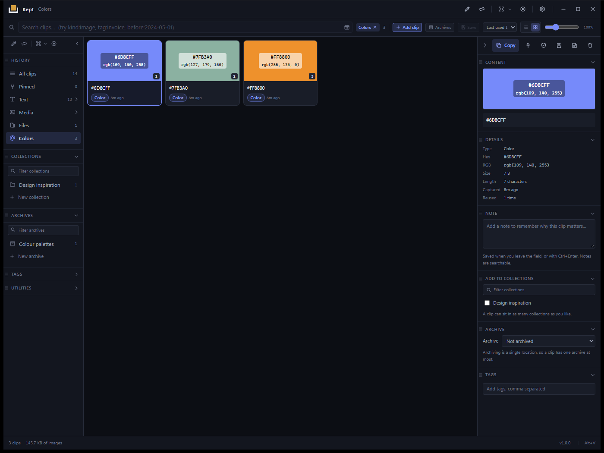

*Colour clips in card view: the swatch, the copied code and its `rgb()` value.*

`Space` on a colour opens it at the size of the panel: the swatch fills the left, and the right
lists the same colour as **HEX**, **RGB** and **HSL**, each with its own copy button — the copy
button takes the value as written, so pasting `hsl(228, 100%, 71%)` into a stylesheet needs no
conversion.

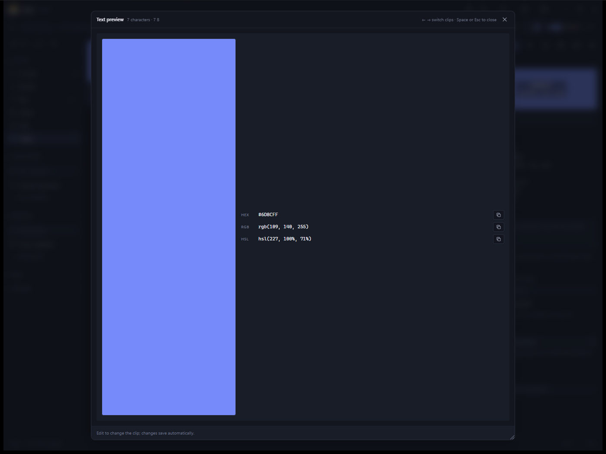

*A colour opened in the preview, with a copy button per format.*

For image clips, the preview pane's **Color scheme** box lists the dominant colors of the
screenshot. It fills in on its own when an image opens — the extraction runs off the UI thread and
is stored with the clip, so reopening a screenshot shows the same scheme instantly instead of
reading the image again. Colors are clustered in OKLab, so "close" means close to the eye, and at
most two of the entries may be near-neutral: a screenshot is mostly white, grey and black, and on
raw frequency those used to fill every slot before an accent was ever reached. Click a swatch to
copy its hex value; the scheme stays on screen while you click through the others.

> **Tip — keep a palette.** **Make Color Palette** files the scheme into a new archive named
> **Color Palette 1**, **Color Palette 2** and so on. Archives stay out of the history and survive
> every bulk delete and retention limit, so a palette you want to keep is safe there; right-click
> the archive in the sidebar to open its folder in Explorer. The confirmation names the archive it
> went into — *Saved 5 colors to “Color Palette 3”.*

The same whole-payload test classifies links, email addresses, Windows paths and JSON. Those clips
are labelled **Link**, **Email**, **Path** or **JSON** in the list and gain the actions that fit
them — *Open link*, *Open*, *Show in Explorer*, *Format JSON* — plus a `type:` search operator.

### Link previews

A link clip shows a tile drawn from its own address: the site's initial on a colour derived from the
host, with the host underneath on a card. That is all offline — nothing is fetched and nothing is
stored.

The page can also be asked for its own picture. Press the image button in the properties pane, or
**Load link preview** in the right-click menu, and Kept fetches the page, reads its OpenGraph
image (Twitter's card, then `rel="image_src"`, if there is no OpenGraph), downloads that image and
keeps a 400px thumbnail; the card then shows the picture instead of the tile. The same guards as the
movie fetcher apply: HTTPS only, public hosts only, redirects pinned to the host that served the
page, a 2 MB page cap and an 8 MB image cap, and only the thumbnail is stored. A secret clip's
preview is sealed with the rest of its media.

*Settings → Capture → Link previews* makes that happen for every copied link, but it is **off by
default**: a clipboard manager that quietly calls out for every address you copy is a different
product from one that never leaves the machine.

Hex values are recognised with or without a leading `#` — `#ff8800`, `ff8800`, `0xFF8800` and the
short `f80` all work — and `rgb()` accepts the CSS Color 4 forms (`rgb(255 136 0)`,
`rgb(255 136 0 / 50%)`). A bare value has to contain both a digit and a letter, which keeps words
like `facade` and numbers like `123456` out of the color view. Hex codes are shown upper-cased
(`#FF8800`) wherever the app displays them; the stored payload keeps whatever case was copied, so
copying it back out is byte-for-byte what you had.

## The preview pane

The pane is available in both layouts, and its own left edge is a drag handle. The width is clamped
to a floor of about 170 px — the width its header's row of buttons needs — and 80% of the window,
and the chosen width is remembered. It stops there so the row is never clipped by the window edge;
below that width the buttons tighten their padding and the **Copy** button drops its label rather
than overflowing. That is a container query on the action row, so the word appears the instant the
row has room for it rather than after the pane's width has been measured. The delete button keeps
16 px of space to its right, so it sits beside the edge instead of on it. Collapsed to a rail, the
whole strip is a button that brings the pane back.

Clips whose content has an obvious next step carry that step as a button, in the pane and in the
row or card itself: a link gets **Open link**, a path gets **Open Folder** (revealed in Explorer) and
a folder icon instead of the plain text glyph.

The pane's sections fold shut from their header, with a chevron on the right showing which way they
are set; the collapsed set is remembered across restarts, and dragging a section's grip still
reorders. The grips sit at the same inset as the sidebar's, so the two columns line up.

**Details** lists the clip's type, its size on disk, the pixel dimensions, how many faces were found,
which application it came from, when it was captured and how often it has been reused. A video adds
its playing time — read from the MP4's own header the first time the clip is selected and remembered
after that, which is why the first look at an old recording is a beat slower than later ones.

Right-clicking a clip offers **Copy**, **Make Sticky**, **Quick preview** (what `Space` does),
**Show properties**,
**Add to Collection** — with **New collection…** at the top of that submenu, which asks for a name,
creates the collection and files the clip into it in one step — **Add to Archive**, whose submenu
leads with **New archive…** and does the same for an archive, the actions the content calls for,
**Make secret** for text, **Save to folder…**, **Pin** and **Delete**. Selecting several clips turns
the same menu into the bulk version, and **Markdown** only appears there when at least one of them is
a text clip, since only text has anything to write.

A video clip leads with **Copy**, which publishes the MP4 — the shape a chat window wants — and adds
a **Copy…** submenu for wanting one part of it: **Copy Thumbnail** (the still frame the card shows,
as an image on the clipboard), **Copy Video File**, **Copy Video URL** and **Copy Video Path** (the
file's location as text). The address is the one recorded when the video was fetched, or the clip's
own payload when the whole copy was a movie address, and **Copy Video URL** is greyed out for a video
whose page never named one. **Show Save Location** opens the folder with the clip's own file
selected — the video rather than the still beside it, or a file list's first path — and is offered
for file clips too.

**Split into stack items…** only appears for text with more than one list item to queue, so the menu
never offers a split that would produce one entry, and **Load link preview** only appears for a text
clip whose payload is a URL.

### Quick preview

`Space` with one clip selected opens a larger view over the history, dimmed and blurred behind it,
sized to the content itself. Images get zoom controls (10–400%, wheel or footer, with a reset) and an
**Edit** button when an editor is set; videos get a player with a scrubbable timeline and the still
frame as the poster; text opens in a larger editor that saves as you type, with the Markdown toolbar
when the clip is Markdown. `←`/`→` browse clip by clip without closing the overlay, a secret stays
blurred until revealed, and `Space` or `Esc` closes it.

Clicking a clip moves the keyboard into the list, so `Space`, the arrow keys and `Del` act on the
selection rather than on the search box. The search box takes the caret when the window is summoned.

### Sticky clips

**Make Sticky** opens a clip in a small always-on-top window sized to its content, so the thing you
copied can sit beside the page you are pasting into. Images zoom and drag, text stays selectable,
Markdown opens rendered with a **Plain**/**Markdown** toggle, links open in the browser and videos
loop. The window follows the clip as it changes — locking the vault blanks its media, an edit shows
the new text — and opening the same clip again raises the window already on screen.

| | |
|---|---|
| 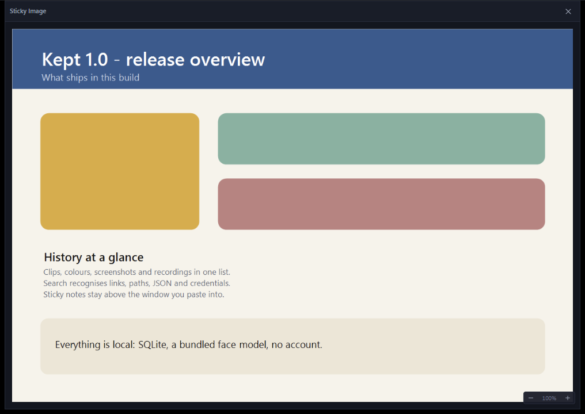 | 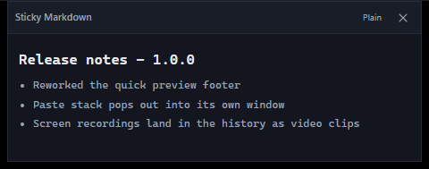 |
| *An image note with its zoom control.* | *A Markdown note, rendered, with the source one click away.* |

## Collections, archives and tags

Hovering a collection in the sidebar reveals two actions: archive it, or delete it. Double-clicking
one — in either list — turns its name into a field, so collections and archives are renamed where they
are shown: `Enter` or clicking away saves, `Esc` abandons the change.

| | Collections | Archive |
|---|---|---|
| How many per clip | As many as you like | Exactly one, or none |
| Where they are edited | The **Add to Collections** picker in the preview pane | The Archive dropdown, under it |
| Effect on the history | None | Hides the clip from the history views and protects it from Clear history and retention |

The backend enforces the split: `set_clip_collections` only rewrites ordinary memberships, so
ticking a collection can never quietly unarchive a clip, and `set_clip_archive` clears any previous
archive before setting the new one.

The **Add to Collections** picker filters as you type, shows the configured number of entries with
**Show all** for the rest, and keeps the clip's own collections as removable pills above the list —
so the checklist only ever offers collections the clip is not in yet.

- An **archive** keeps its clips out of All clips, Text, Images, Files, Pinned, tags and search
  results; selecting the archive itself is how you reach them. The search bar's **Archives**
  toggle (or `in:archive`) reaches them from anywhere. When a view comes up empty because the
  only matches are archived, the empty state says so and offers **Include N archived items**,
  which is the same toggle without leaving the list to find it.
- Archived clips survive both *Clear history* variants and the retention limits, so an archive is
  a safe place for the things history should never eat.
- Unarchiving the collection puts its clips straight back into the history views.
- **New archive** sits under the Archives section and creates the collection already archived, so
  an archive can be made without first making a collection and then converting it.
- Deleting a collection asks first, and only the grouping goes away — the clips never do.
- Every archive owns a folder under `archives/` in the data directory. Right-click the archive in
  the sidebar to open it; renaming the collection renames the folder, and unarchiving removes it
  once it is empty.

Hovering a list row or a card also offers a **copy** button. It puts the clip on the clipboard and
leaves the window open, unlike `Enter` or a double click, which copy-and-dismiss.

An image row or card gains a pencil beside that copy button when an editor is set up: **Settings →
Image editor** takes any program that accepts a file path — Paint, IrfanView, something custom — and
Kept launches it with the clip's PNG. Arguments after the program are passed through, so an
editor that needs a mode flag works too; `{file}` marks where the image's path goes and it is
appended when the command has no `{file}`. The same pencil appears on a card's top-right hover
icons, on the right of a row, in the quick preview's footer and in the right-click menu, and all of
them disappear again when the setting is cleared. A video never offers it: the still frame beside a
recording is its poster, and editing that would leave the movie untouched. Images sealed in the
vault are refused with an explanation: on disk those files are ciphertext, and an editor saving over
one would flatten the seal.

The archive picker in the preview pane is a dropdown of every archive plus *Not archived*, so
filing a clip takes one click instead of scanning a radio list.

Right-clicking a clip opens a small menu with an icon on every entry. *Copy* leads the list, and
*Add to Collection* / *Add to Archive* open fly-outs of the matching collections; images and file
lists can also be revealed in Explorer (the stored PNG, or the original path with a fallback to
its folder), and *Pin* works from there too.

Tags are managed from the sidebar: double-click one to rename it in place, or right-click for the
same rename in a dialog plus a color dot and delete. Renaming onto a name that already exists merges
the two tags rather than failing, and the search index is rebuilt so results follow the new name
straight away. The **Tags** section also has a filter box: type to narrow the tag list, press `Enter`
to open the first match, `Esc` to clear it. Collections and Archives use the same filter box, show the
configured number of entries, and offer **Show all** with a compact scrolling list when there are
more.

## Utilities: emoji

*Utilities → Emoji* opens a searchable, category-by-category emoji library. The search matches names
and keywords ("rocket", "thank you", "deploy"); click an emoji to copy it, or right-click to pin it
to **Favourites**. Anything copied this way lands in the history with *Emoji* as its source.

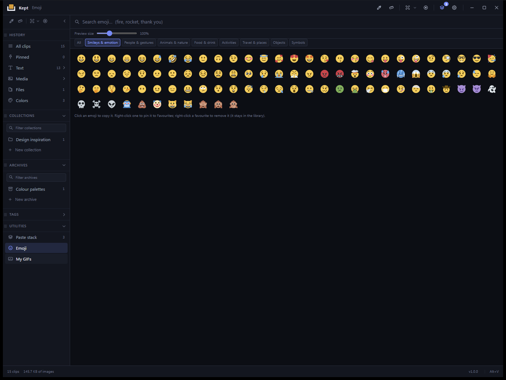

The artwork is bundled [Twemoji](https://github.com/jdecked/twemoji) (v17.0.3, by jdecked and other
contributors, [CC BY 4.0](https://creativecommons.org/licenses/by/4.0/) — see
`public/emoji/twemoji/NOTICE.txt`), so the cells do not depend on how Windows rasterises colour
glyphs; the clipboard still receives the Unicode character. Regional-indicator flags are left out
because Windows has no flag glyphs.

### Colour schemes from an archive

Open an archive that holds more than one colour clip and the list carries a small bar above it with
**Copy Color Scheme**: every hex in the archive, one per line, in the order the list shows them,
uppercased and de-duplicated. It appears only there — an archive of colours is the one place where a
scheme is a thing you keep, so it is not offered under All clips, Text, the Colors section or a plain
collection.

## Utilities: My GIFs

*Utilities → My GIFs* searches GIPHY and copies the animation you pick: the downloaded GIF is placed
on the clipboard as a file (image targets paste the animation, text targets get its address).
Search needs a free GIPHY API key, entered once in *Settings → Utilities*; it is kept in the local
settings and only used for these requests.

Star a result to pin it to **Your GIFs** at the top, which wraps onto new rows instead of
scrolling sideways. The shelf also accepts image clips: open one
in the preview pane and press the button in its header — the same works for a video clip, including
one that started life as a pasted movie address, so the shelf holds both kinds side by side.
**Add GIF or MP4** imports a `.gif` or
`.mp4` from disk; the file is validated by its bytes rather than its name, copied into the media
folder and added to the shelf like a starred result. Shelf items backed by a clip are filed into a hidden, system-owned **Saved GIFs**
archive at the same moment, which takes the clip out of the history and out of every delete path:
emptying the clip list, clearing an archive or letting the retention limit expire can no longer
break a link on the shelf. Taking the item off the shelf is the only way to put the clip back into
the history. That archive never appears in the collection list, the collection pickers or the
settings, so it cannot be renamed, emptied or deleted by accident. The search box filters **Your GIFs** as well as the GIPHY results, and clears with
the **×** beside it. The **Preview size** slider matches
the history grid's card-size control, and the choice is remembered.

The **Loop** toggle above the grid decides whether previews keep animating: on, every animation
loops continuously; off, each one holds a still frame and plays only while the pointer is over it.
Every preview can pause this way: GIPHY results use the static rendition from the API, clip-backed
favourites use their stored thumbnail, and imported GIF files (plus favourites saved before the
static rendition existed) are drawn to a canvas that holds its current frame until hovered. History
views follow the same hover behaviour, so a screen full of GIFs is not a screen full of motion.
Animated clips also carry a small badge in the top-left corner of their card — a film frame for a
GIF, a camera for a video.

A captured video is kept as the MP4 the page served, not re-encoded and not renamed to `.gif`:
pages such as Reddit publish one under a `.gif` path with `?format=mp4`, and the query is what
decides how the bytes are stored. It plays through a muted `<video>` with the copied still frame as
its poster, so nothing downloads or makes a sound until you hover. Copying the clip puts the MP4
file on the clipboard, exactly as the GIF path does, and a clip sealed in the vault keeps its video
sealed with the rest of its media.

Pasting a movie address works without a browser. When the entire copied payload is one `https://`
link to a `.gif`, `.mp4`, `.m4v` or `format=mp4` asset — the address a browser's *Copy video
address* gives you — the clip is fetched the same way and becomes a movie clip: camera badge, hover
playback,
listed under **GIFs & videos**, and copying it yields the file rather than the link. While the
fetch is in flight the card says **Downloading** with a pulsing clock, and it turns into the player
the moment the file lands; a fetch that fails leaves an ordinary link and no spinner behind. The
window re-reads the list whenever it regains focus, so a download that finished while Kept was
hidden is already on screen when you bring it back. The text of the
link is still stored, so it stays searchable with `type:url` and keeps its *Open link* action. A
sentence that merely mentions an address is left alone.

## Add a clip note

**Add clip** in the toolbar opens a small **New clip** window: type or paste the text, optionally
with the Markdown buttons. It **auto-saves as you type** — the first pause becomes a clip and later
pauses rewrite it — so closing the window never loses the draft. **New** keeps that clip and starts
another in the same window; **Copy as new** leaves the clip as it is and continues from the same text,
with the next edit becoming a separate clip; **Done** or `Ctrl+Enter` closes. The text is stored
without touching the clipboard, so the watcher never sees it and no second row appears. Whether it is
Markdown is decided when it is saved — a heading, fence, quote, list, table, link or paired emphasis
earns a **Markdown** badge and a `type:markdown` filter.

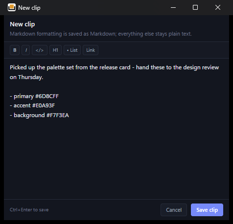

*Type or paste, optionally format it, and save without touching the clipboard.*

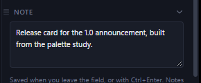

*Every clip also takes a note in the preview pane; it is saved with the clip and searched.*

## Notes and editing

Every clip has a **Note** field in the preview pane. The note saves when the field loses focus (or
with `Ctrl+Enter`), is stored with the clip, and is included in search results; a note icon marks
the clip in list and card views.

For text clips, double-click the preview to edit the body in place. `Ctrl+Enter` saves and `Esc`
cancels. Editing drops any captured HTML/RTF so stale formatting cannot be pasted over the new
text, and refuses to turn one clip into an exact duplicate of another.

## Color picker

The eyedropper next to the settings button hides Kept and samples the next spot you click on
screen. A small topmost magnifier follows the crosshair, zooming the pixels beneath it and showing
the exact pixel and its hex/RGB values; it flips at monitor edges and never takes focus. While a
pick is pending the click is swallowed by a low-level mouse hook, so sampling a colour cannot also
press a button, open a dropdown or pause a video underneath. Esc cancels, and cancelling (or
letting the pick time out) closes the picker without an error message. The sampled `#rrggbb`
value goes on the clipboard, is added to history, and the window returns focused on the **Colors**
view with the new swatch selected.

## Screen capture

One capture button in the title bar repeats the kind you used last; its chevron opens all five —
**Region**, **Window**, **Full screen**, **Scrolling** and **Text** — plus **Capture the previous
area** and **Capture Delay Settings…**. Window captures read UI Automation so the page comes out
without the tab strip or border, scrolling capture wheels the window and stitches only the new rows,
and a delay counts down in the corner so a menu can be opened first. The result is an ordinary image
clip — thumbnail, OCR pass, history entry — and it is left on the clipboard, the way the Snipping
Tool leaves its own.

**Text** is the exception: it takes the same region drag, but the recognised words are stored as a
text clip instead of the picture, so a block of text on screen — a log line, an error dialog, a
passage in a PDF — pastes straight into an editor. Nothing is read if the area holds no words, and
the recognition runs on the machine: the Windows engine, Vision on macOS, `tesseract` on Linux.


*The chevron opens every capture kind; the tick marks the one the button repeats.*

**Hide while capturing** keeps the app out of its own screenshot, and the capture outline colour is
chrome only — the captured pixels never contain it. Every kind has an optional shortcut in *Settings
→ Capture → Capture shortcuts*, and **Print Screen** can be handed over from the Snipping Tool.

## Onscreen ruler

> **Linux (Beta):** on X11 the ruler behaves as described below. On Wayland it also opens, but the
> compositor does not hand it global keys, so `Esc` closing depends on the session and a locked ruler
> is released with the **Unlock** chip it shows. Snapping to colour edges needs a screenshot, which
> needs X11 (`maim`); window snapping sees XWayland windows only.

The ruler opens from the title bar, the sidebar, the tray menu or its opt-in shortcut and covers the
primary monitor. Select, distance, box and angle tools give pixel readouts; guides are dragged from
the edge rulers; endpoints snap to windows, colour edges, guides or a grid (`Alt` bypasses snapping,
`F5` refreshes the snapshot). The padlock makes it click-through, and **Copy** writes the active
measurement to the clipboard and to history in px, DIP or both.

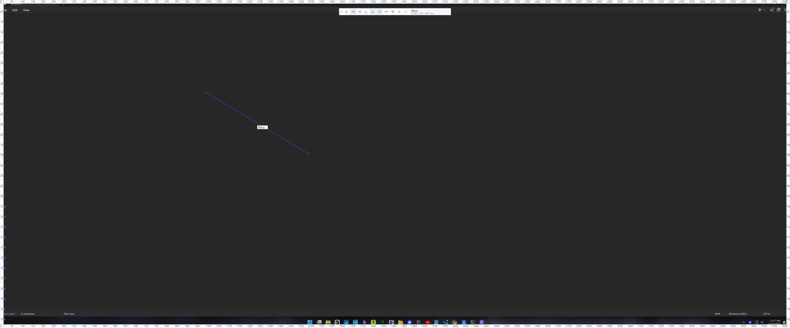

## Screen recording

The record button — in the sidebar's capture strip, in the title bar and on its optional shortcut —
opens a small always-on-top bar: **Whole screen**, **Window**, **Region** or **Fixed size**, with sound and
pointer switches. Once recording starts the bar becomes a timer with pause and stop, stays above other
windows while the app is minimised, and pauses at a keyframe so resuming costs no frames.


The finished MP4 arrives as an ordinary video clip — poster frame, player, *Media → Screen
recordings* — and is put on the clipboard as a file. **Export as GIF** offers four sizes. FFmpeg is
the only external program Kept uses, and *Settings → Screen Recording → Install FFmpeg* fetches it
with winget when it is missing; the section also holds the audio source, the frame rate, the pointer
switch and the record/stop/pause shortcuts.

## Facial recognition

Image clips are scanned once, on a background thread, by YuNet — the 227 KB model from OpenCV Zoo,
executed by [tract], a pure-Rust ONNX interpreter. The model ships inside the executable, so there is
nothing to download, no service and no network call. Only a count is kept, never an embedding, so a
database reader cannot match one clip's face against another; the result appears as **Images →
People**, and *Capture → Detect faces* turns the scan off.

[tract]: https://github.com/sonos/tract

## Where things live

```
src/                        React frontend
  lib/ipc.ts                the only place `invoke` is called
  lib/types.ts              TypeScript mirrors of the Rust DTOs
  lib/theme.ts              palettes and the CSS custom-property bridge
  hooks/useHistory.ts       list + search state, debounced, subscription to backend events
  hooks/useUpdater.ts       daily update check, download progress and relaunch
  components/               chrome, list, detail pane, settings
src-tauri/src/
  lib.rs                    app wiring: plugins, tray, hotkey, media URI scheme
  clipboard.rs              capture loop and all Win32 clipboard access
  store.rs                  SQLite storage, plain-text payloads, pruning, in-memory index
  storage.rs                data-folder pointer, relocation and cleanup
  ocr.rs                    text recognition for screenshots (Windows.Media.Ocr)
  faces.rs                  face detection for image clips (YuNet on tract)
  palette.rs                dominant-colour extraction for screenshot schemes
  giphy.rs                  GIPHY search, URL allow-listing and GIF downloads
  animated.rs               recovers the source GIF or video when a browser copies an image
  autocomplete.rs           the `::` keyboard hook, trigger matching and the quick-paste window
  preview.rs                a link clip's page title and preview picture, on request
  picker.rs                 screen colour sampling, the eyedropper magnifier, input guards
  capture.rs                capture overlays, the window picker, scrolling capture and pixels
  stitch.rs                 measuring the scroll between frames, and holding fixed panes
  recorder.rs               screen recording: the FFmpeg session, segments and pausing
  uia.rs                    UI Automation: the element under the pointer
  crypto.rs                 one-time legacy decryption for histories from older builds
  search.rs                 relevance scoring
  media.rs                  image/thumbnail persistence
  media_cache.rs            local copies of thumbnails and stills the window has read
  paste.rs                  foreground window tracking + synthetic Ctrl+V
```

## Security model

Clips are stored locally in SQLite. Ordinary clips are plain text, so anyone who can read the data
folder can read them. **Clips marked secret are encrypted** — see below.

Kept makes a network request only when you ask it to, and says so each time:

| What | When |
|---|---|
| The page or image address a copied picture came from | to keep an animated GIF or video, or a link's preview image — only while the copy is being recorded |
| GIPHY search and downloads | while you are using *Utilities → My GIFs*, and only with your API key |
| The latest release manifest and installer | the daily update check, which *Settings → About* turns off |
| A link's preview picture | when you press *Load preview*, or on every copied link if you turned automatic previews on |

None of them carries your history, your clips or an identifier: each request is the address alone,
over HTTPS, to a public host. Automatic link previews are the one path that runs without a click,
and they are **off by default**.

**Quick paste is the only part of Kept that looks at what you type elsewhere.** Its keyboard hook is
installed only while *Settings → Quick paste* is switched on, it compares the last few characters
against your trigger without keeping them, and it is unhooked the moment the setting goes off. It
never runs over the applications listed under *Never there*, over Kept's own windows, or over a
window belonging to a program running as administrator.

### The vault

Marking a clip as a secret encrypts it; unmarking decrypts it back into an ordinary clip. The first
time you do it, Kept asks for a passphrase and creates a vault.

- A random 32-byte **data key** encrypts the rows; your passphrase only wraps that key. Changing
  the passphrase therefore rewraps 32 bytes instead of re-encrypting the history, and sealed clips
  survive it untouched.
- The passphrase is stretched with **Argon2id** (64 MiB, 3 passes), which is deliberately expensive
  to guess in bulk. Values are sealed with **AES-256-GCM**, a fresh nonce for each one, so two
  identical secrets do not look alike in the file.
- Everything portable lives **inside the database**: the salt and the wrapped key travel with it.
  Copy `copypaste.db` to another machine, open that folder in Kept, and the passphrase is all
  you need. Nothing is bound to this PC.
- Pressing **Reveal** on a locked secret asks for the passphrase, from the list, a card or the
  properties pane, instead of quietly doing nothing.
- A restart always comes back **locked**. While locked, sealed clips read as nothing at all —
  not blurred, not partially visible — and cannot be searched, copied, previewed or exported.
  They say *Locked* so the empty row is never a mystery.
- Marking a secret without a vault is refused rather than stored in the clear: there is no key, so
  there is nothing to encrypt with.
- **There is no recovery.** Lose the passphrase and the sealed clips are unreadable. That is what
  encryption means; there is no back door and no escrow.

**What the vault protects:** the database file at rest, backups of it, and a copy taken to another
machine, against someone without the passphrase.

**What it does not protect:** a machine that is compromised *while Kept is running and
unlocked* (the key is in memory, and the clips are decrypted to be read), a keylogger, memory
inspection, or a screenshot of the window. A passphrase written on a note next to the keyboard is
outside every guarantee here.

**Image clips too.** Marking an *image* secret encrypts its files as well — the full image, its
thumbnail and any recovered animation — in place under the same names, so nothing that already
refers to them has to change. A locked vault serves no pixels: the card and the row show a lock
rather than a broken frame, and unmarking the secret decrypts the files back. Attaching an animation
to a clip that is already sealed writes it sealed.

**Search and sealed clips.** While the vault is locked, a sealed clip does not match a search, and
its text is not in the in-memory index. That is deliberate rather than unfinished: making sealed rows
searchable would mean holding their plaintext somewhere, which is exactly what the vault exists to
prevent. Unlock the vault and the clips read normally again.

Older builds encrypted the payload columns with AES-256-GCM under a DPAPI-wrapped key. On the first
start after upgrading, those rows are decrypted, rewritten as plain text and the `key.bin` file is
deleted. If a legacy row cannot be decrypted it is left alone and reads as empty rather than as
garbage; `key.bin` is kept in that case so a later attempt can retry.

**Deliberate trade-offs, stated plainly:**

- **The database is not protected at rest.** Rely on OS file permissions, an encrypted system
  drive, or a separate Windows account if the machine is shared.
- **Content hashes are stored in the clear.** SHA-256 digests serve as the de-duplication key.
  They are one-way, but equal payloads remain *detectable* to someone reading the database.
  De-duplication is impossible otherwise.
- **Search runs over an in-memory index of clip text.** Search mirrors the first 16 KB of each
  clip's plaintext in memory; for text clips larger than 256 KB only the preview is indexed, so a
  term deep inside a very large paste will not match.
- **The webview serves images through a custom `media` URI scheme**, with a filename allowlist
  rather than a filesystem scope, so the frontend is never granted directory access.
- **Face detection happens on-device, with a bundled model.** The detector needs no network, no
  service and no account, and it records a count rather than an embedding, so a database reader
  cannot use it to match one clip's face against another.

Respecting opt-outs: copies flagged with `ExcludeClipboardContentFromMonitorProcessing`, or whose
`CanIncludeInClipboardHistory` / `CanUploadToCloudClipboard` is zero, are ignored. This is how
password managers mark secret material, and the setting is on by default.

## Releases and automatic updates

Pushing a `v*` tag runs [`.github/workflows/release.yml`](./.github/workflows/release.yml), which:

- runs backend tests and builds/signs the Windows NSIS installer, publishes the GitHub release and
  `latest.json`, and attaches a stable `Kept_x64-setup.exe` alias; and
- builds and uploads Linux (Beta) end-user packages (`.AppImage`, `.deb`, `.rpm`) to the same
  release.

Installed Windows copies poll
`https://github.com/jamesbuckley-source/kept/releases/latest/download/latest.json`, verify the
signature against the public key in `tauri.conf.json`, and install in place. Automatic in-app update
delivery is currently focused on the Windows signed updater artifacts.

Two repository secrets drive signing, and losing either breaks future signed Windows updater releases:

| Secret | Purpose |
|---|---|
| `TAURI_SIGNING_PRIVATE_KEY` | minisign private key used to sign update artefacts |
| `TAURI_SIGNING_PRIVATE_KEY_PASSWORD` | password protecting that key |

Keep a backup of the private key: a release signed with a different key is rejected by installed
copies. The update check is on by default; *Settings → About* turns it off and offers a manual
check. When a release is waiting, the banner names the version and lists the headlines of what is in
it, with a *What's new* link beside it to the full notes; the first launch after an update offers the
same link. *Show latest updates* in About always has something real to show: the pending release's
notes when one is waiting, and otherwise the notes bundled with the version you are running, so they
read the same offline. Linux users can install/update by downloading the latest packages from the
releases page while Linux support is in Beta.

## Tests

```powershell
cd src-tauri
cargo test                 # backend suite

cd ..
npm run build              # type-checks the frontend
```

The suite covers legacy encrypted-history migration, plain-text round trips, search ranking
(content and tags), de-duplication, ordering by capture date or last use, retention pruning in days
and hours, archive protection from pruning and clear-history, color-code recognition, Markdown
detection (including the near-misses it must reject), Markdown note rendering with YAML escaping,
CRLF normalisation and filename collisions, clips typed by hand, collection/tag behaviour,
data-folder relocation and cleanup, theme sanitising, text recognition from a rendered
image fixture, media path-traversal rejection, the `DROPFILES` layout used for file lists, the
quick-paste trigger and deny-list normalisation, and KeptCraft detection and its command line.

Four tests are `#[ignore]`d: two because they touch the live system clipboard, and two because
they need FFmpeg and a desktop on the machine — one records two seconds of the screen and checks the
MP4 it produces, the other checks that the encoder's audio devices are found and parsed.

```powershell
cargo test -- --ignored
```

For a manual pass over capture and classification, open [docs/demo.html](docs/demo.html) in a
browser. It has copy-ready samples for every recognised payload shape — colors in all supported
forms, links, emails, Windows paths, JSON, synthetic secrets, rich text, an image/OCR pair and a
script that creates a demo file list.

## Known limitations

- Windows-only. The key-wrapping layer deliberately fails loudly elsewhere rather than silently
  writing an unprotected key.
- Deleted clips are unlinked, but storage is not securely erased; SSD wear-levelling makes
  guarantees there impossible.
- Search covers the first 16 KB of a clip (see above).
- File clips record paths; if the files move afterwards the entry is stale.

## License

Kept is free software: you can redistribute it and/or modify it under the terms of the
GNU General Public License as published by the Free Software Foundation, either version 3 of the
License, or (at your option) any later version.

Kept is distributed in the hope that it will be useful, but WITHOUT ANY WARRANTY; without
even the implied warranty of MERCHANTABILITY or FITNESS FOR A PARTICULAR PURPOSE. See the
[GNU General Public License](./LICENSE) for more details.

Third-party components keep their own licenses (React, Vite, Tailwind CSS and Tauri are MIT or
Apache-2.0); see `package-lock.json` and `src-tauri/Cargo.lock` for the full set. The bundled face
model is the MIT-licensed YuNet from OpenCV Zoo — its licence text ships beside it in
`src-tauri/assets/yunet.LICENSE`.
